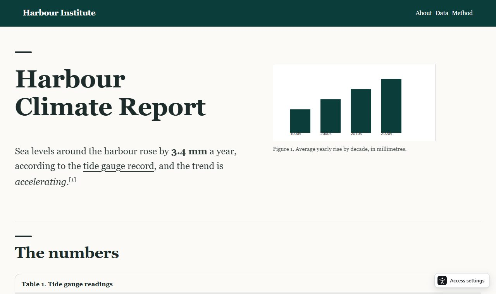

# Access

**Access rebuilds any web page, in place, so you can actually use it.** Click the Access icon in Chrome or Edge and the page you are on is replaced, in the same tab and at the same URL, by a redesigned version with the site's own colours, fonts, pictures and logo. Nothing on the page is thrown away, and you can get the original back with one click.

Demo Video: https://youtu.be/lPBnF6skqYQ

There are three modes, plus an optional AI button:

| Mode | For | What it does |
|---|---|---|
| **Focus** | ADHD, anxiety, fatigue | The page as a short slide deck: one idea at a time, key points, a progress bar and a reading line. |
| **Motor impairment** | head or eye control, no precise mouse | Huge targets, "Big tiles" with a few choices at a time, dwell-to-click, on-screen keyboard, scroll zones. Optional head-controlled mouse with a deliberate right-eye wink to click (Windows). |
| **Screen reader** | blind and low-vision | Real landmarks, one heading outline, skip links, clear link names, real tables; optional AI descriptions for pictures. |
| **AI redesign** (optional) | all | One click: [Apify](https://apify.com) reads the whole site (hidden menus, main pages), then [Claude](https://www.anthropic.com/claude) plans the page with that site map. |



Everything runs on your computer. The extension talks only to a small local server (`127.0.0.1:4173`); API keys live in a local `.env` file and never reach the extension or the page.

## Quick start

You need [Node.js](https://nodejs.org) 20 or newer and Chrome or Edge.

```bash
git clone https://github.com/yassinabdelal-ipynb/access.git
cd access
npm install
node server.mjs
```

Then load the extension:
1. Open `chrome://extensions` (or `edge://extensions`) and turn on **Developer mode**.
2. Choose **Load unpacked** and select the `extension` folder of this project.
3. Open any website, click the Access icon, then **Redesign this page**.

Everything except the AI features and head control works without any keys, and without the server running.

### Optional: AI (Claude) and the site reader (Apify)
Copy `.env.example` to `.env` and fill in what you want (never share these keys; `.env` is git-ignored):

```bash
ANTHROPIC_API_KEY=   # Claude: page plans, tile titles, picture descriptions
APIFY_TOKEN=         # Apify: reads the whole public site for the AI redesign
```

Restart `node server.mjs`. It prints `AI ready` and `site reader ready` when each key is found. For Apify, approve the **Cheerio Scraper** once in Apify Console (otherwise Apify refuses the run and Access tells you so). Without an Apify token the AI button still works with Claude alone.

Before anything is sent, Access shows a consent dialog that says exactly what goes where. Passwords and what you type into fields are never sent.

### Optional: head control (Windows)
Head control moves the desktop mouse with your head and clicks with a right-eye wink held for three seconds. It needs a webcam and Python 3.10 to 3.12:

```bash
python -m pip install -r requirements.txt
```

If `python` is not the right interpreter, set `ACCESS_PYTHON=C:\path\to\python.exe` in `.env`. Choose **Motor impairment**, then **Head control**. Camera pictures never leave the Python program; only landmark numbers are used. See [MOTOR_ACCESS.md](MOTOR_ACCESS.md).

## How it works
1. **Scan** (`extension/engine.js`): reads the page like a person would, into plain data: headings, paragraphs with their links and emphasis, tables, charts, pictures, forms, landmarks, and the site's own look.
2. **Design** (`extension/ui.js`, `access.css`): draws a clean version over the page in a shadow-DOM overlay and marks the original inert.
3. **Act**: your typing and clicks are forwarded to the original page, with confirmation before anything that could submit.
4. **AI (optional)**: Claude may only name the main content, hide distractions (recoverable), fold side content, add short headings, write short gists and label what each stretch is for. It cannot touch fields or buttons or reword anything, and the server re-checks every instruction.

The full description of every feature, the privacy rules, limits and the server API is in [PROJECT_BRIEF.md](PROJECT_BRIEF.md). Screen reader details: [SCREENREADER.md](SCREENREADER.md).

## Design tokens and Figma
Colours and radii live in one file, `design/tokens.json`, and are generated into the extension, popup and site CSS:

```bash
npm run tokens         # regenerate the CSS
npm run test:tokens    # CSS in sync, WCAG contrast of every colour pair, Figma export matches
```

A Figma variables collection ("Access Tokens", Light and Dark) mirrors the tokens; see [design/FIGMA.md](design/FIGMA.md). Figma is design-time only: nothing at run time calls it.

## Tests
The browser tests need a running server (`node server.mjs`) and use Microsoft Edge through Playwright (the extension test loads the real unpacked extension).

```bash
npm test                    # companion page
npm run test:extension      # the real extension in Edge
npm run test:reader         # screen reader mode
npm run test:content        # nothing is dropped, in every mode
npm run test:chrome
npm run test:tiles
npm run test:site
npm run test:siteagent      # Apify + Claude flow (mocked services)
npm run test:apify          # Apify agent (mocked service)
npm run test:tokens
npm run test:motor
npm run test:facelock       # needs Python with numpy
```

The AI and Apify tests use mocked services, so they need no keys and spend nothing.

## Project layout
```
extension/        the Chrome/Edge extension (Manifest V3)
server.mjs        local server; server/ holds the Claude, Apify and head-control code and the rulebooks
app/              project page and demo pages used for development and tests
design/           design tokens and the Figma sync
scripts/          token generator and Figma importer
eye-tracking/     the head-controlled mouse (Python, Windows)
tests/            test suites
```

## Privacy
- Keys only in your local `.env`; the server binds to `127.0.0.1` and rejects requests that are not from the extension or the local site.
- Consent dialog before the first AI request and before pictures are described.
- Field values and passwords are never sent. Apify receives only the page's web address without query or fragment, and only for public sites.
- Camera frames stay inside the local Python program.

## Limits
Prototype, not a WCAG conformance claim. Not yet tested with real screen readers or phones. Works on the top document and standard elements: no cross-origin frames, closed shadow roots, or script-drawn widgets (these show as a card that opens the original page). Head control is Windows only. Browser settings and store pages cannot be changed by extensions.

## Third-party
Fonts Atkinson Hyperlegible and Sora (SIL OFL, licences in `extension/fonts`). The MediaPipe Face Landmarker model in `eye-tracking/models` is from Google (Apache 2.0).

## License
[MIT](LICENSE)
